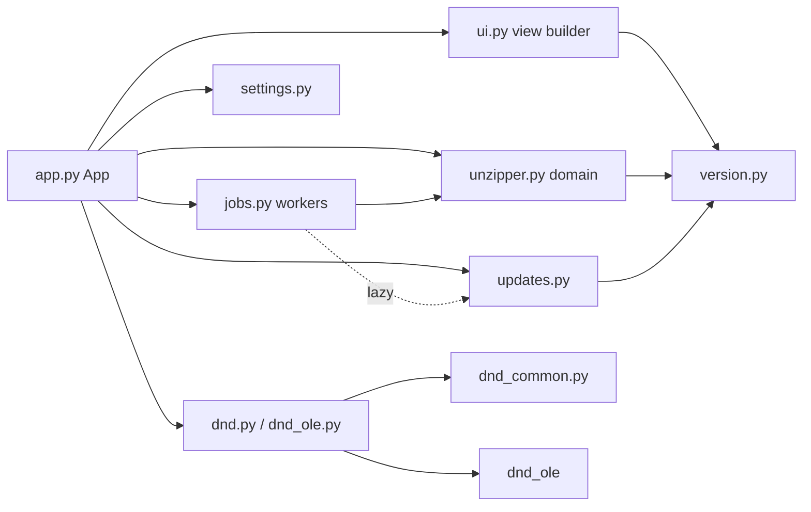

# Architecture map — かんたん解凍 (unzip-tool)

Baseline: `origin/main` @ `fab7d5a` (v1.2.13). Work: isolated worktree `refactor/architecture` at `C:/vibe/unzip-tool-arch`.
This document is the shared map for entropy-reduction rounds. Update it in the same commit as the code it describes.

## Non-negotiable invariants (from product decisions / history)

| Invariant | Authority | Why |
|---|---|---|
| Workers write only to a private staging dir; the parent publishes on a terminal event | `unzipper._extract_into` / `jobs.BackgroundTask.poll` | No overwrite of existing results; half-extracted output never visible |
| All entries are validated before extraction: path/special names, links/special files, case-insensitive and file/folder collisions | `unzipper._safe_join`, `_validate_entries`, per-format guards | Core safety contract (Issue #1, PR #2) |
| No Tk calls from `WndProc`; drop data is polled by the Tk thread | `dnd.py` / `App._poll_events` | Cross-process re-entry crashed the app |
| `version.py` is the only version literal; CI, Inno and release scripts derive it | `version.py`, `tests/test_version_consistency.py` | Prevents silently shipping the wrong version |
| Update asset must come from the official release and match published SHA256 | `updates.py` | Supply-chain boundary |
| `KANTAN_UNRAR` is authoritative; no fallback when the configured path is wrong | `unzipper.find_unrar_tool` | Deterministic RAR policy (Issue #80) |
| Settings are one JSON file; env vars only isolate tests/QA | `settings.py`, `tests/conftest.py` | Single settings store |
| ZIP = ZipCrypto only; no split archives, SFX, AES-ZIP, merge into existing destination | `README.md` | Explicit product non-goals |

## Module ownership

| Module | Owns | Public surface | Must not reach into |
|---|---|---|---|
| `unzipper.py` | Format detection, listing, safety, extraction, staging helpers, RAR policy, error translation | `FORMATS` (planned), `is_supported`, `detect_kind`, `list_contents`, `extract_archive`, `archive_needs_password`, `error_message`, `DISK_FULL_MESSAGE`, `available_dest`, `publish_staging`, `clean_staging`, `find_unrar_tool`, `default_dest_for` | Tk, `app`, `ui`, settings store |
| `jobs.py` | Worker processes/thread fallback, event protocol, staging publication/cancellation | `BackgroundTask`, `ThreadTask` | Widget state; it emits tuples only |
| `updates.py` | Release check, download, SHA256 verification, curl fallback | `check_latest`, `download_update`, `version_number` | Tk, job state |
| `settings.py` | Settings schema, geometry validation, path resolution | `Settings`, `config_dir`, `settings_path`, `parse_geometry`, `valid_geometry`, `placeable_geometry`, `virtual_screen` | Tk widgets, update logic |
| `app.py` | `App` orchestration: job state, polling, user actions, update flow | `App`, `ArchiveJob`, `main` | Direct filesystem extraction (uses `unzipper`/`jobs`) |
| `ui.py` | Stateless view construction and tokens | `build_widgets`, `build_help_window`, `set_update_chip`, `paint_drop_area`, `Tooltip`, style tokens | Business state ownership |
| `dnd.py` / `dnd_ole.py` / `dnd_common.py` | Windows drop messages, OLE target, HDROP decoding | `enable_drop`, `take_dropped_files`, `take_truncated_files`, `is_drag_over`, `register`, `revoke` | Tk calls inside OS callbacks |

No import cycles today. Two *semantic* cycles to keep under control: `ui ↔ App` (duck-typed widget attrs and back-calls) and `dnd ↔ dnd_ole` (callback injection). Neither may become an import cycle.

## State ownership

| Owner | State | Readers/writers |
|---|---|---|
| `App` | `jobs`, `selected`, `busy`, `_listing`, `_extracting`, `_pending/_batch`, update phase fields, timers | Only Tk thread; tests reach into a few privates (`_listing`, `_drag_over`) |
| `ArchiveJob` | per-card domain fields + ~25 Tk handles | `App` is sole writer; tests construct/inspect it |
| `ui` | only `Tooltip._after/_tip` | Everything else is injected onto `view` |
| `dnd` | `_hooks/_pending/_truncated` keyed by hwnd | OS callback writes, `App._poll_events` drains |
| `dnd_ole` | `_targets/_drag_over/_drag_allowed/_owns_apartment` | COM callbacks + register/revoke |
| `BackgroundTask` | `operation/dest/staging/process/connection/finished` | Parent only creates, publishes, cancels |
| `unzipper` | `_rar_tool_ready` (spawn-process-local), `os.environ` reads | Tests reset explicitly |

## Authority and duplication inventory

| Concept | Authority | Other copies | Status |
|---|---|---|---|
| Format suffixes & kind | `unzipper.FORMATS` (+ derived `SUPPORTED_SUFFIXES`, `DIALOG_FILTERS`) | `ui.HELP_SECTIONS`, `unzipper.default_dest_for` stripping, installer ISS | Round 1 consolidated Python side; installer literal lines are constrained by text tests |
| User-facing domain messages | `unzipper.py` named constants (`DISK_FULL_MESSAGE`, `PASSWORD_*`, `LINK_UNSUPPORTED_MESSAGE`, `DANGEROUS_PATH_MESSAGE`) | RAR-only link wording (single use, semantically distinct) | Round 2 consolidated all repeated literals; wording unchanged |
| Terminal worker events | `jobs.TERMINAL_EVENTS` + `jobs.UNEXPECTED_EXIT_MESSAGE` | update-specific `('done','error')` gate in `app._finish_check` (different protocol) | Round 3 consolidated all five terminal consumers; behaviour unchanged |
| Version | `version.py` | 3 PowerShell regex parsers, README examples | Later batch; README literals are test-pinned |
| Geometry limits | `settings.MIN_WIDTH/MIN_HEIGHT` | `app.minsize(700,680)`, PowerShell QA regex | Deferred: aligning changes visible behavior |
| Status colours | `app.STATE_BADGE` (job state) vs `ui.UPDATE_CHIP_STYLES` (update phase) | — | Intentional: different concepts, do not merge |
| Format badge vs filter labels | `app.FORMAT_BADGE` vs `unzipper.DIALOG_FILTERS` | — | Intentional: badge is short UI label, filter is dialog group |

## Technology doubles (all have real callers)

- `urllib` + `curl.exe` fallback on certificate errors (`updates.py`) — intentional; both covered.
- Spawn process + `ThreadTask` fallback (`jobs.py`) — intentional; cancellation semantics differ (deferred decision D1).
- JSON settings / HKCU registry associations / release JSON — distinct stores.
- Python import / three PS regex parsers for version — redundant; candidate A4.

## Deviations and deferred decisions

See `task-pool.md` (D1–D4) and `adr/0004-deferred-decisions.md`. Nothing there may be "fixed" by weakening a test, a validation gate, or an explicit non-goal.

## Navigation

- [ADRs](adr/) · [Task pool](task-pool.md) · [Progress log](progress.md)
